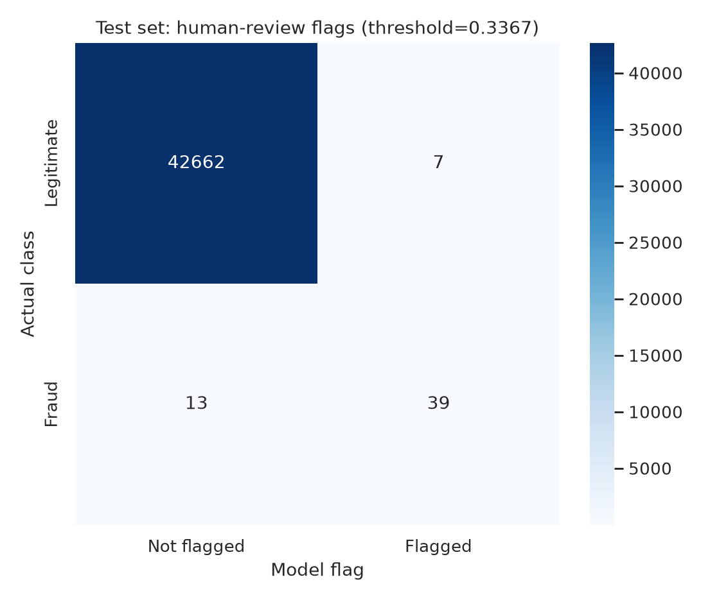
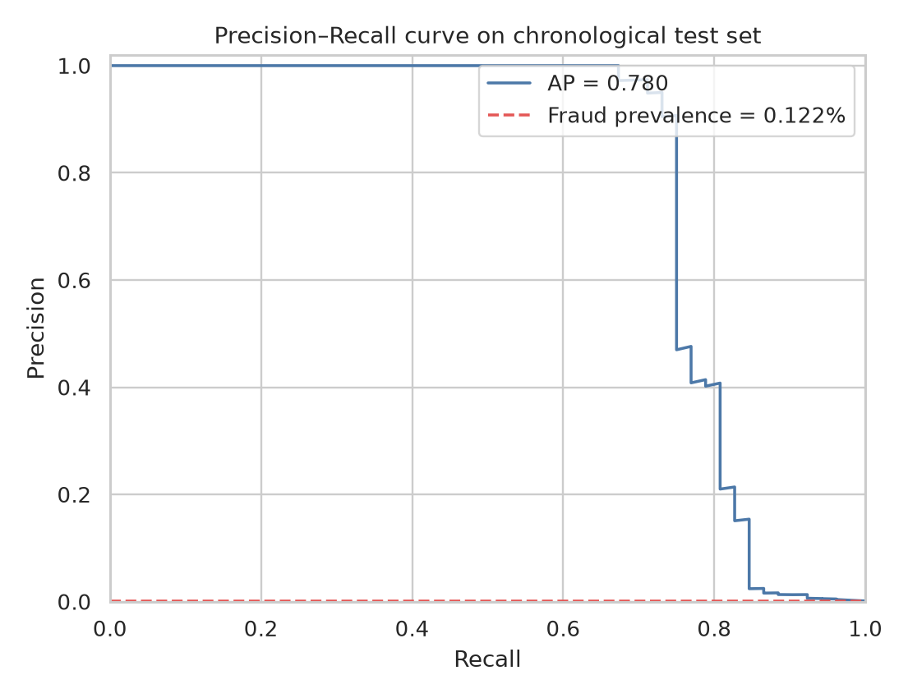

# Fraud / Transaction Risk Detection

A reproducible educational machine-learning project that ranks suspicious card transactions for **trained human review**. It is designed around extreme class imbalance, time-ordered evaluation, and the trade-off between catching fraud and creating review workload.

> **Safety and scope:** This is a portfolio demonstration—not a production fraud system. Scores are not calibrated probabilities. A score must not be treated as a fraud verdict, used to accuse a customer, or used to automatically block or decline a transaction.

## Demo

[Watch the project demo video](https://drive.google.com/file/d/14WGUcBcR8Zp98CoPYVc7bVwhlrA1S-PH/view?usp=sharing).

## Results at a glance

The model and operating threshold were selected using a chronological validation partition. The selected threshold was then frozen for the later-time test partition.

| Held-out test metric | Result |
|---|---:|
| Average Precision (AP; often summarized as PR-AUC) | **0.7798** |
| ROC-AUC | **0.9616** |
| Precision at selected review threshold | **84.8%** |
| Recall at selected review threshold | **75.0%** |
| F1 at selected review threshold | **0.7959** |
| Test transactions sent to review | **46 / 42,721** |
| Confusion counts (TN, FP, FN, TP) | **42,662; 7; 13; 39** |

These are historical benchmark results, not a forecast of performance on current transactions. There are only 52 fraud labels in the test partition, so the threshold metrics are sensitive to a small number of cases.

## What the project does

- Uses the public ULB / Worldline European card-transaction dataset: 284,807 rows and 492 fraud labels (0.173%). The raw file is downloaded on demand and is not bundled.
- Splits records chronologically by unique `Time` values, keeping identical timestamps together: approximately 70% train, 15% validation, and the final 15% test.
- Compares a class-weighted Logistic Regression baseline with a class-weighted Random Forest. The model is selected by validation Average Precision rather than accuracy.
- Selects a review threshold on validation to meet a target recall of at least 70%, choosing the highest-precision feasible point. The threshold is **0.336665**; its achieved validation recall is **78.6%**.
- Reports threshold trade-offs, a confusion matrix, a precision-recall curve, and validation permutation importance.
- Separates a blinded, label-free example review queue from test exports that contain labels for retrospective evaluation.

## Quick start

Requires Python 3.10 or newer. Run these commands from the repository root:

```bash
python -m venv .venv
# macOS / Linux
source .venv/bin/activate
# Windows PowerShell: .venv\Scripts\Activate.ps1

python -m pip install -r requirements.txt
python src/download_data.py --output data/raw/creditcard.csv
python src/train_fraud.py \
  --data data/raw/creditcard.csv \
  --output . \
  --target-recall 0.70
```

Run the automated tests with:

```bash
python -m pip install -r requirements-dev.txt
python -m pytest -q
```

The downloader fetches the dataset from a public Hugging Face mirror and verifies range responses and chunk sizes. As with any third-party mirror, verify the source and dataset terms before redistribution. The original raw dataset is intentionally excluded from this repository.

### Score a label-free CSV for review

After training (or with the included trusted model artifact), provide a CSV containing the trained feature columns (`Time`, `Amount`, and `V1`–`V28`) and no target labels:

```bash
python src/score_transactions.py \
  --input path/to/unlabelled_transactions.csv \
  --output reports/powerbi/scored_review_queue.csv
```

The output is ranked by score and includes `Fraud_Risk_Score` and `Flag_For_Human_Review`. It is a review aid only; an analyst must independently assess context before any action. Only load model artifacts from sources you trust.

## Key files

- [`src/train_fraud.py`](src/train_fraud.py) — preprocessing, time split, model comparison, threshold selection, evaluation, plots, and artifacts.
- [`src/download_data.py`](src/download_data.py) — verified chunked download of the public CSV mirror.
- [`src/score_transactions.py`](src/score_transactions.py) — label-free scoring CLI for human-review prioritization.
- [`notebooks/Fraud_Risk_Detection.ipynb`](notebooks/Fraud_Risk_Detection.ipynb) — Google Colab walkthrough.
- [`reports/Evaluation_Report_EN.md`](reports/Evaluation_Report_EN.md) — evaluation and limitations.
- [`reports/Risk_Threshold_Memo_EN.md`](reports/Risk_Threshold_Memo_EN.md) — operating-threshold rationale and cost framework.
- [`reports/threshold_tradeoffs.csv`](reports/threshold_tradeoffs.csv) — candidate threshold comparison on validation and test.
- [`reports/powerbi/blinded_review_queue_demo.csv`](reports/powerbi/blinded_review_queue_demo.csv) — flagged example rows without labels or outcomes.
- [`reports/powerbi/test_evaluation_predictions.csv`](reports/powerbi/test_evaluation_predictions.csv) — **retrospective evaluation only**; contains test labels and must not be used as an operational review queue.
- [`docs/model-card.md`](docs/model-card.md) — intended use, evaluation, and risks.
- [`docs/dataset-card.md`](docs/dataset-card.md) — dataset provenance, fields, and limitations.

### Evaluation figures





## Threshold and business impact

The threshold is a demonstration operating point, not a financially optimal policy. Review cost, reviewer capacity, recoverable loss, and customer impact were not provided. For a real organization, estimate a cost function such as:

`false-positive reviews × cost per review + missed frauds × expected unrecovered loss per missed fraud`

Then choose an operating point with finance and operations, subject to analyst capacity and customer-impact constraints. Transaction `Amount` is not itself a measured fraud loss.

## Limitations

- The dataset covers a short historical period in September 2013 (roughly two days) and does not represent current transaction behavior.
- `V1`–`V28` are anonymized PCA components. Their predictive importance does not give them business meaning or establish causality.
- The chronological holdout helps avoid training on later records, but it is still one historical test window and contains only 52 fraud examples.
- The scores are not claimed to be calibrated probabilities; validation and current-population calibration would be needed before operational use.
- This demonstration does not evaluate fairness, customer outcomes, analyst capacity, recovery rates, or real financial costs.

For details, see the [model card](docs/model-card.md), [dataset card](docs/dataset-card.md), and [evaluation report](reports/Evaluation_Report_EN.md).

## Licensing

No software license is included yet. Add a license you have the right to grant before inviting reuse. The third-party dataset has separate terms; this repository does not grant rights to redistribute it.
